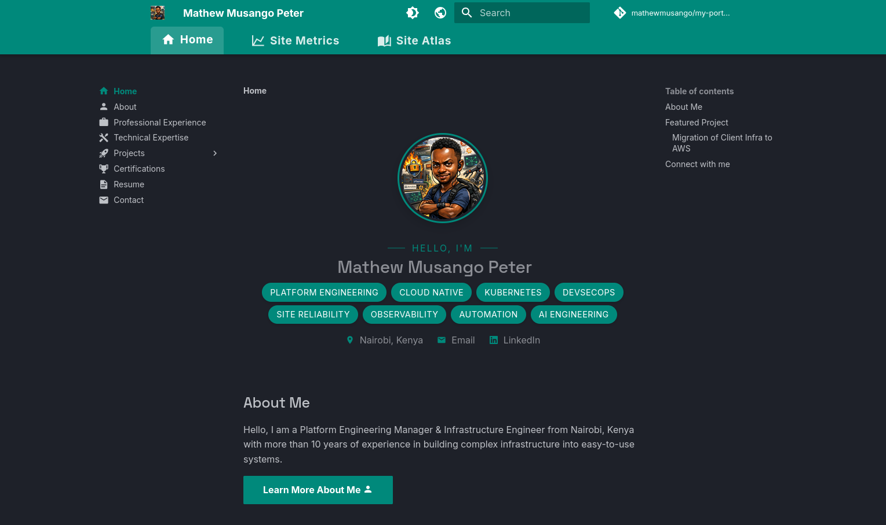

# My Portfolio

  
  
  
  
  
  
  

*The live site — [mathewmusango.github.io/my-portfolio](https://mathewmusango.github.io/my-portfolio/)*

> **Personal project developed in the open** — the process here is deliberate practice,
> not a community project.
>
> My open-source work lives in **[Emuplane](https://github.com/mathewmusango/emuplane)**,
> my first OSS project: a console and control plane for AWS-compatible emulators, where
> open source and software delivery (DevOps, DevSecOps, platform engineering, security,
> operations) have room to go further, along with best coding practice.

This repository is the source of
[mathewmusango.github.io/my-portfolio](https://mathewmusango.github.io/my-portfolio/):
a platform engineer's portfolio built with MkDocs + Material and run like a production
service — gated multi-environment releases, least-privilege OIDC roles, and visitor
analytics that never store an IP address.

| What | Terms |
| --- | --- |
| **Code** | MIT — see [LICENSE](LICENSE) |
| **Content** | © Mathew Musango Peter, all rights reserved — text, resume, certifications and images |

## What is in here

| Part | What it is |
| --- | --- |
| **Content delivery** | One `docs/` tree in three languages (en · es · zh), built once and promoted to staging, to the prod S3 + CloudFront mirror (OAC only) and to GitHub Pages |
| **Visitor analytics** | CloudFront geo headers → API Gateway → writer / reader Lambdas → DynamoDB — no IPs stored, 90-day TTL |
| **Infrastructure** | Terraform: `bootstrap` (state backends + per-job OIDC roles) plus the `infra/site` and `infra/metrics` roots, one state each |

**[Platform Architecture](https://mathewmusango.github.io/my-portfolio/atlas/platform-architecture/)**
on the site shows how the three parts fit together, diagrams included; the AWS
implementation is in [`terraform/README.md`](terraform/README.md).

## Documentation

- [The live site](https://mathewmusango.github.io/my-portfolio/) — profile, experience,
  projects, skills, resume.
- [`terraform/README.md`](terraform/README.md) — the site and metrics stacks, the event
  schema, security and local AWS emulation.
- [`scripts/README.md`](scripts/README.md) — the dev image, the tooling and the check
  scripts CI runs.
- [`SECURITY.md`](SECURITY.md) — vulnerability reporting.
- [`CHANGELOG.md`](CHANGELOG.md) — release history.

## License

[MIT](LICENSE)
