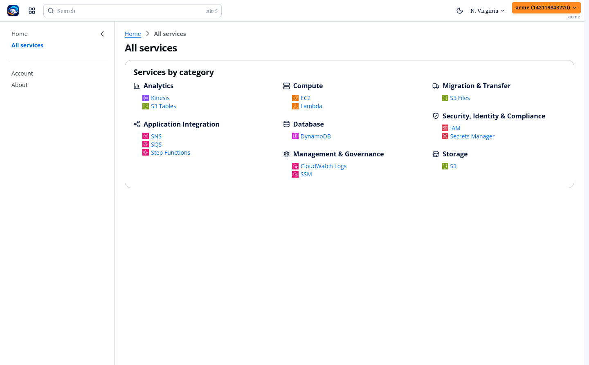

# Open Source & Emuplane

!!! note "A personal project"
    Emuplane is my own open-source project, developed independently of my
    employer. Nothing on this page describes an employer's system.

An AWS emulator makes one developer's laptop feel like AWS. It does not make
the emulator usable by more than one person: there is an implicit account, a set
of credentials on local disk, and usually no console at all. Emuplane is the
control plane I built to close that gap. It fronts the emulator — MiniStack, in
my setup — so the accounts, the logins inside them, and the clients that sign
requests are all real, and shared.

- **The project:** [github.com/mathewmusango/emuplane](https://github.com/mathewmusango/emuplane)
- **The docs:** [mathewmusango.github.io/emuplane](https://mathewmusango.github.io/emuplane/?utm_source=mathewmusango.github.io)
- **The image:** [`ghcr.io/mathewmusango/emuplane`](https://github.com/mathewmusango/emuplane/pkgs/container/emuplane)
- **The licence:** [MIT](https://github.com/mathewmusango/emuplane/blob/main/LICENSE)

{ loading=lazy }
*The Emuplane console after sign-in — the services menu, built on AWS Cloudscape.*

## Why an emulator needs a control plane

Local emulators are genuinely useful: they make S3, IAM, or DynamoDB available
in a test loop without an AWS account or a bill. The moment more than one person
needs that same emulator, the soft edges show up:

- **One account, no login.** Everybody is the same caller, so a policy that
  should deny one user cannot be exercised.
- **Credentials on disk.** Access keys are pasted into profiles and shells,
  never issued, never distinguishable — the audit trail starts at "someone".
- **No console.** An emulator is an API, so anything a person wants to look at
  is a CLI call or a hand-written script.
- **Tools point at nothing.** Terraform and the AWS CLI need an endpoint, and
  each tool has its own way of being told about it.

Emuplane answers exactly those four problems, and stops there. **It is not an
AWS replacement, and the project says so** — it makes an emulator multi-user and
tool-shaped; it does not chase AWS parity.

## Architecture

Emuplane sits between the clients and the emulator, and owns the identity layer
the emulator lacks:

| Layer | What it does |
|---|---|
| **Python API gateway** | The control API, the access-key issuing, and the request path the clients sign against |
| **React console** | The browser surface, built on the AWS Cloudscape design system |
| **DynamoDB** | Account, identity, and session state — stored through the emulator itself |
| **Docker Compose** | One command brings up the control plane and the emulator together |
| **GitHub Actions** | 14 workflows covering tests, scanning, images, and releases |

Terraform and the AWS CLI point their endpoint at Emuplane. Emuplane holds the
accounts and the logins inside them, issues the access keys those clients sign
with, and serves the console and the control API on top of the same state — so
what you see in the browser is what the CLI is acting on.

### The Python API gateway

The gateway is the only component that has to be trusted with identity. It
holds the accounts and the logins inside them, and it issues the access keys the
clients sign with — one endpoint, one identity model, for every tool that talks
to the emulator.

### The React console

The console is built on **AWS Cloudscape**, AWS's own open-source design system,
so the emulator's console reads like the console people already know. It is a
front end over the control API, which keeps behaviour in one place: a route in
the browser and a CLI call are the same operation.

### Data and local runtime

State lives in **DynamoDB through the emulator**, which keeps the stack honest —
Emuplane does not require a database the emulator could not provide. **Docker
Compose** brings the control plane and the emulator up together, so a new
machine or a CI job gets a working emulator in one command.

## What shipped

Between **2026-11-05 and 2026-11-23** the project went from nothing to a usable
product: **16 git tags from `v0.1.0` to `v0.9.0` in three weeks**, **15 GitHub
releases**, **337 commits**, roughly **22,800 lines of Python** plus a React
front end, and **14 CI workflows**.

### The console surface

- **S3** — buckets, objects, versions, ACLs, lifecycle / notification / logging
  documents, and multipart uploads.
- **IAM** — users, groups, roles, policies, identity providers, account
  settings, a credential report, and an API explorer.
- **Accounts and sign-in** — an account model with logins inside it, rather than
  one implicit identity.
- **A per-service coverage ledger** — each service states what is implemented
  and what is not.

### IAM, MFA and sign-in

IAM is where an emulator is easiest to fake and hardest to get right, so it got
the most attention: **TOTP MFA** and explicit **sign-in challenges** in the
console's authentication path, and **98 of 98 advertised IAM operations tested**.

### The release pipeline

The repository works like a real open-source project, on purpose:

- **PR-only `main`** — squash-only, one issue per PR, `Closes #N` in the body.
- **Labels drive the release** — the issue label decides which changelog section
  a change lands in and which part of the version moves.
- **Docs frozen per release** — a release's documentation is frozen with it.

### Supply chain

- **Trivy gates every release** — a scan is a release condition, not a report.
- **Container images on GHCR**, tagged `X.Y.Z` and `latest`.
- **Every release carries an SBOM (SPDX), `SHA256SUMS`, and `IMAGE-DIGEST`**, so
  the artifact can be verified without trusting the pipeline that built it.
- **400+ pytest tests and 121 vitest tests** on the front end.
- **OpenSSF Best Practices badge at 100%.**

## Lessons learned

- **An emulator's gaps belong in a published limits page.** Users hit the
  boundary between "this emulator does not emulate that" and "Emuplane does not
  implement that" constantly; a documented limits page turns an argument into a
  referral.
- **A coverage ledger per service is worth more than a feature list.** Stating
  what is covered, and what is deliberately not, is what makes an emulator
  trustworthy for testing — and it is what makes a claim like "98 of 98 IAM
  operations" checkable.
- **Console routes need a server-side entry.** A client-side route in a single
  page app is not reachable when someone types it or refreshes; each console
  route has to exist as a real entry point.
- **The emulator is not the hard part — the identity model is.** Once accounts
  and keys are real, everything else has somewhere to live.

## Links

- **Source:** [github.com/mathewmusango/emuplane](https://github.com/mathewmusango/emuplane)
- **Docs:** [mathewmusango.github.io/emuplane](https://mathewmusango.github.io/emuplane/?utm_source=mathewmusango.github.io)
