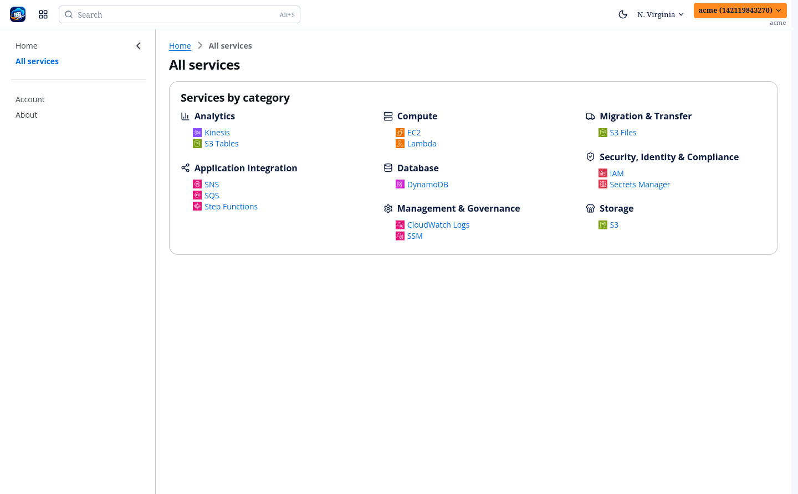

# Código Abierto y Emuplane

!!! note "Un proyecto personal"
    Emuplane es mi propio proyecto de código abierto, desarrollado de forma
    independiente de mi empleador. Nada en esta página describe un sistema de
    un empleador.

Un emulador de AWS hace que el portátil de un desarrollador se sienta como AWS.
No hace que el emulador sea usable por más de una persona: hay una cuenta
implícita, un juego de credenciales en el disco local y, normalmente, ninguna
consola. Emuplane es el plano de control que construí para cerrar esa brecha.
Se sitúa delante del emulador — MiniStack, en mi caso — para que las cuentas,
los inicios de sesión dentro de ellas y los clientes que firman las peticiones
sean reales, y compartidos.

- **El proyecto:** [github.com/mathewmusango/emuplane](https://github.com/mathewmusango/emuplane)
- **La documentación:** [mathewmusango.github.io/emuplane](https://mathewmusango.github.io/emuplane/?utm_source=mathewmusango.github.io)
- **La imagen:** [`ghcr.io/mathewmusango/emuplane`](https://github.com/mathewmusango/emuplane/pkgs/container/emuplane)
- **La licencia:** [MIT](https://github.com/mathewmusango/emuplane/blob/main/LICENSE)

{ loading=lazy }
*La consola de Emuplane tras iniciar sesión — el menú de servicios, construido sobre AWS Cloudscape.*

## ¿Por qué un emulador necesita un plano de control?

Los emuladores locales son genuinamente útiles: ponen S3, IAM o DynamoDB en el
bucle de pruebas sin una cuenta de AWS ni una factura. En el momento en que más
de una persona necesita ese mismo emulador, aparecen los bordes blandos:

- **Una cuenta, sin inicio de sesión.** Todos son el mismo llamante, así que una
  política que debería denegar a un usuario no se puede ejercitar.
- **Credenciales en disco.** Las claves de acceso se pegan en perfiles y shells:
  nunca se emiten, nunca se distinguen — la trazabilidad empieza en "alguien".
- **Ninguna consola.** Un emulador es una API, así que todo lo que una persona
  quiere mirar es una llamada de CLI o un script escrito a mano.
- **Las herramientas apuntan a nada.** Terraform y la AWS CLI necesitan un
  endpoint, y cada herramienta tiene su propia forma de recibirlo.

Emuplane responde exactamente a esos cuatro problemas, y se detiene ahí. **No es
un reemplazo de AWS, y el proyecto lo dice**: hace que un emulador sea multiusuario
y tenga la forma de las herramientas; no persigue la paridad con AWS.

## Arquitectura

Emuplane se sitúa entre los clientes y el emulador, y es dueño de la capa de
identidad que al emulador le falta:

| Capa | Qué hace |
|---|---|
| **Pasarela API en Python** | La API de control, la emisión de claves de acceso y la ruta de peticiones contra la que firman los clientes |
| **Consola en React** | La superficie de navegador, construida sobre el sistema de diseño AWS Cloudscape |
| **DynamoDB** | Estado de cuentas, identidades y sesiones — almacenado a través del propio emulador |
| **Docker Compose** | Un solo comando levanta el plano de control y el emulador juntos |
| **GitHub Actions** | 14 workflows que cubren pruebas, escaneo, imágenes y releases |

Terraform y la AWS CLI apuntan su endpoint a Emuplane. Emuplane guarda las
cuentas y los inicios de sesión dentro de ellas, emite las claves de acceso con
las que firman esos clientes, y sirve la consola y la API de control sobre ese
mismo estado — así que lo que ves en el navegador es aquello sobre lo que actúa
la CLI.

### La pasarela API en Python

La pasarela es el único componente que debe ser de confianza en materia de
identidad. Guarda las cuentas y los inicios de sesión dentro de ellas, y emite
las claves de acceso con las que firman los clientes — un endpoint y un modelo
de identidad para cada herramienta que habla con el emulador.

### La consola en React

La consola está construida sobre **AWS Cloudscape**, el sistema de diseño de
código abierto del propio AWS, para que la consola del emulador se lea como la
consola que la gente ya conoce. Es un front end sobre la API de control, lo que
mantiene el comportamiento en un solo sitio: una ruta en el navegador y una
llamada de CLI son la misma operación.

### Datos y ejecución local

El estado vive en **DynamoDB a través del emulador**, lo que mantiene la pila
honesta: Emuplane no exige una base de datos que el emulador no pudiera
proporcionar. **Docker Compose** levanta el plano de control y el emulador
juntos, así que una máquina nueva o un job de CI obtienen un emulador
funcionando con un solo comando.

## Lo que se entregó

Entre el **2026-11-05 y el 2026-11-23** el proyecto pasó de nada a un producto
usable: **16 tags de git de `v0.1.0` a `v0.9.0` en tres semanas**, **15 releases
de GitHub**, **337 commits**, unas **22.800 líneas de Python** más un front end
en React, y **14 workflows de CI**.

### La superficie de la consola

- **S3** — buckets, objetos, versiones, ACLs, documentos de ciclo de vida,
  notificaciones y logging, y subidas multiparte.
- **IAM** — usuarios, grupos, roles, políticas, proveedores de identidad,
  ajustes de cuenta, un informe de credenciales y un explorador de API.
- **Cuentas e inicio de sesión** — un modelo de cuentas con inicios de sesión
  dentro de ellas, en lugar de una única identidad implícita.
- **Un registro de cobertura por servicio** — cada servicio declara qué está
  implementado y qué no.

### IAM, MFA e inicio de sesión

IAM es donde un emulador es más fácil de falsificar y más difícil de acertar, así
que se llevó la mayor atención: **TOTP MFA** y **desafíos de inicio de sesión**
explícitos en la ruta de autenticación de la consola, y **98 de 98 operaciones
de IAM anunciadas, probadas**.

### El pipeline de entrega

El repositorio funciona como un proyecto de código abierto real, a propósito:

- **`main` solo por PR** — solo squash, una issue por PR, `Closes #N` en el
  cuerpo.
- **Las etiquetas dirigen el release** — la etiqueta de la issue decide en qué
  sección del changelog aterriza un cambio y qué parte de la versión se mueve.
- **Documentación congelada por release** — la documentación de un release se
  congela con él.

### Cadena de suministro

- **Trivy condiciona cada release** — un escaneo es una condición del release,
  no un informe.
- **Imágenes de contenedor en GHCR**, etiquetadas `X.Y.Z` y `latest`.
- **Cada release lleva un SBOM (SPDX), `SHA256SUMS` e `IMAGE-DIGEST`**, para que
  el artefacto se pueda verificar sin confiar en el pipeline que lo construyó.
- **Más de 400 pruebas de pytest y 121 pruebas de vitest** en el front end.
- **Insignia OpenSSF Best Practices al 100%.**

## Lecciones aprendidas

- **Los huecos de un emulador pertenecen a una página de límites publicada.** Los
  usuarios chocan constantemente con la frontera entre "este emulador no emula
  eso" y "Emuplane no implementa eso"; una página de límites documentada
  convierte una discusión en una referencia.
- **Un registro de cobertura por servicio vale más que una lista de
  funcionalidades.** Declarar qué está cubierto, y qué no lo está a propósito, es
  lo que hace que un emulador sea fiable para probar — y lo que hace comprobable
  una afirmación como "98 de 98 operaciones de IAM".
- **Las rutas de la consola necesitan una entrada en el servidor.** Una ruta de
  cliente en una single page app no es alcanzable cuando alguien la escribe o
  recarga; cada ruta de la consola tiene que existir como punto de entrada real.
- **El emulador no es la parte difícil — el modelo de identidad sí.** Una vez
  que las cuentas y las claves son reales, todo lo demás tiene dónde vivir.

## Enlaces

- **Código:** [github.com/mathewmusango/emuplane](https://github.com/mathewmusango/emuplane)
- **Documentación:** [mathewmusango.github.io/emuplane](https://mathewmusango.github.io/emuplane/?utm_source=mathewmusango.github.io)
